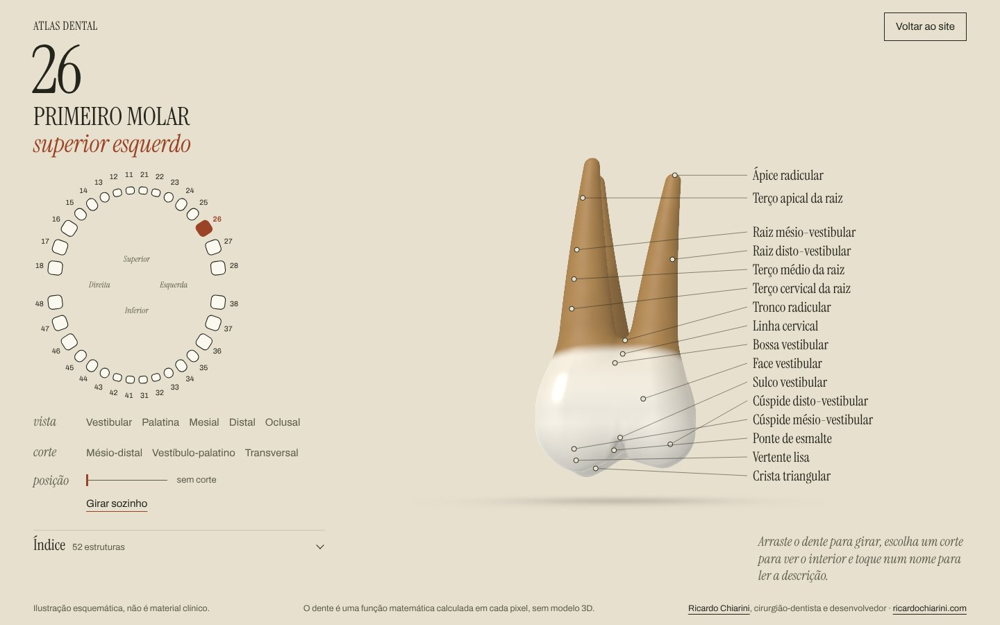

# Atlas dental em WebGL

**[Abrir o atlas](https://ricardochiarini.com/atlas/)** · [Como foi feito](https://ricardochiarini.com/atlas-dental.html)

[](https://ricardochiarini.com/atlas/)

Atlas de anatomia dental que roda no navegador: cada dente pode ser girado, aberto em três planos de corte e tem as estruturas nomeadas e descritas.

**Não há modelo 3D.** Nenhuma malha, textura ou arquivo importado: cada dente é uma função matemática, avaliada em cada pixel por um shader.

Dentes prontos: os 32 da dentição permanente, em 16 fichas. O lado direito é o espelho do esquerdo, e os dentes superiores aparecem de coroa para baixo. Toda a morfologia ainda está em revisão pelo autor.

## Como funciona

A técnica é a de campos de distância (SDF) com marcha de raios.

- A função `dente(p)` devolve a distância de um ponto qualquer até a superfície. Ela é montada somando e subtraindo formas simples com transições suaves: caixa arredondada para a coroa, esferas para as cúspides, cápsulas escavadas para os sulcos, cones para as raízes.
- Para cada pixel sai um raio da câmera, que avança de acordo com a distância informada até encostar na superfície.
- **O corte** é a interseção do dente com um meio-espaço: `max(dente(p), dot(p, plano) - posição)`.
- **Os tecidos** são regiões da mesma função. O esmalte é a faixa próxima da superfície, acima da junção amelocementária e mais espessa nas cúspides. A cavidade pulpar é outra função de distância (câmara, cornos e canais). O cemento é uma faixa fina sobre a raiz. O que sobra é dentina.

## Um dente é uma ficha de dados

A forma de cada dente é escrita **uma única vez**, como uma árvore de peças ([`src/no.ts`](src/no.ts)). Dessa árvore saem duas coisas:

- o **código GLSL** que o shader usa para desenhar (`emite`);
- as **mesmas funções em TypeScript** (`avalia`), que o atlas usa para prender cada nome no ponto exato da superfície, saber que tecido existe num ponto do corte e esconder os nomes que ficam atrás do dente.

Com isso, desenho e rótulos nunca saem de sincronia.

| Arquivo | Papel |
|---|---|
| [`src/no.ts`](src/no.ts) | As peças (esfera, caixa, cone...), as operações (unir, escavar, curvar, espelhar) e os dois geradores. |
| [`src/dentes/molar-inferior.ts`](src/dentes/molar-inferior.ts) | O molde dos molares inferiores: monta forma, cavidade pulpar, cortes e estruturas a partir das medidas de cada dente. |
| [`src/dentes/molares-inferiores.ts`](src/dentes/molares-inferiores.ts) | As fichas do 36, do 37 e do 38: cúspides, sulcos, raízes, canais e textos. |
| [`src/dentes/catalogo.ts`](src/dentes/catalogo.ts) | Os 32 dentes na notação FDI. O lado direito é o espelho do esquerdo, com rótulos e cortes espelhados juntos. |
| [`src/modelo.ts`](src/modelo.ts) | As funções de um dente em TypeScript: tecido, normal, assentar um ponto na superfície, teste de oclusão. |
| [`src/base.frag`](src/base.frag) | O shader comum: marcha de raios, luz, sombra e a pintura dos tecidos no corte. |
| [`src/odontograma.ts`](src/odontograma.ts) | As duas arcadas em vista oclusal, para trocar de dente. |
| [`src/main.ts`](src/main.ts) | Câmera, cortes, posicionamento dos nomes e troca de dente pelo endereço (`#36`). |

## O atlas

- **Nomes presos ao dente.** Cada estrutura externa tem âncoras na superfície; aparece a que estiver virada para a câmera e não estiver escondida.
- **Nomes no corte.** Cada estrutura interna é um conjunto de pontos em 3D. Em qualquer posição do plano, o nome aparece onde a estrutura de fato cruza o corte.
- **Três planos:** mésio-distal, vestíbulo-lingual e transversal, com posição ajustável.
- **Cinco vistas:** vestibular, lingual, mesial, distal e oclusal.
- **Índice por grupo**, com chave para mostrar ou esconder os nomes de cada grupo.

## Outros cuidados

- **Desenho sob demanda:** um quadro só é calculado quando algo muda. Se o aparelho não acompanhar, a resolução interna cai aos poucos.
- **Cores compartilhadas:** o shader lê as mesmas variáveis CSS da página, então acompanha os temas claro e escuro.
- **Movimento reduzido:** com essa preferência no sistema, as animações de câmera e de corte ficam desligadas. `?semanim` no endereço faz o mesmo.

## Limites

É uma ilustração esquemática, não material clínico. A nomenclatura segue a escola brasileira de anatomia dental e está em revisão.

## Rodar

```bash
npm install
npm run dev
```

## Licença

Código aberto para leitura, como portfólio. Todos os direitos reservados: veja [LICENSE](LICENSE).

## Créditos

Anatomia, design e código por [Ricardo Chiarini](https://ricardochiarini.com), cirurgião-dentista e desenvolvedor. As funções de distância básicas seguem as fórmulas publicadas por Inigo Quilez. A fonte é a Instrument Serif, sob a SIL Open Font License.
